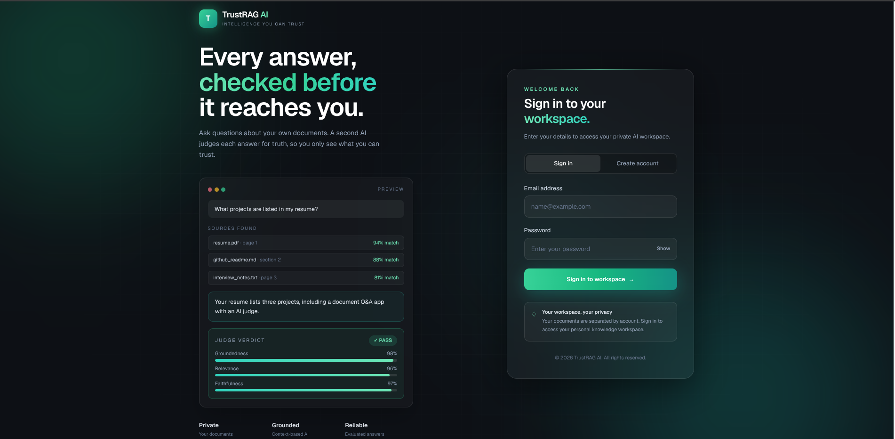
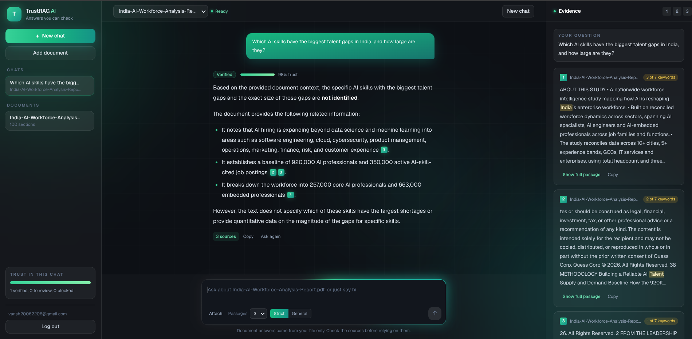
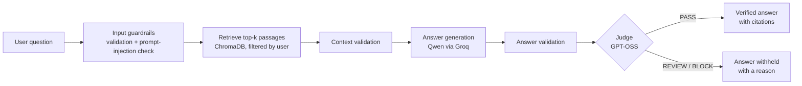
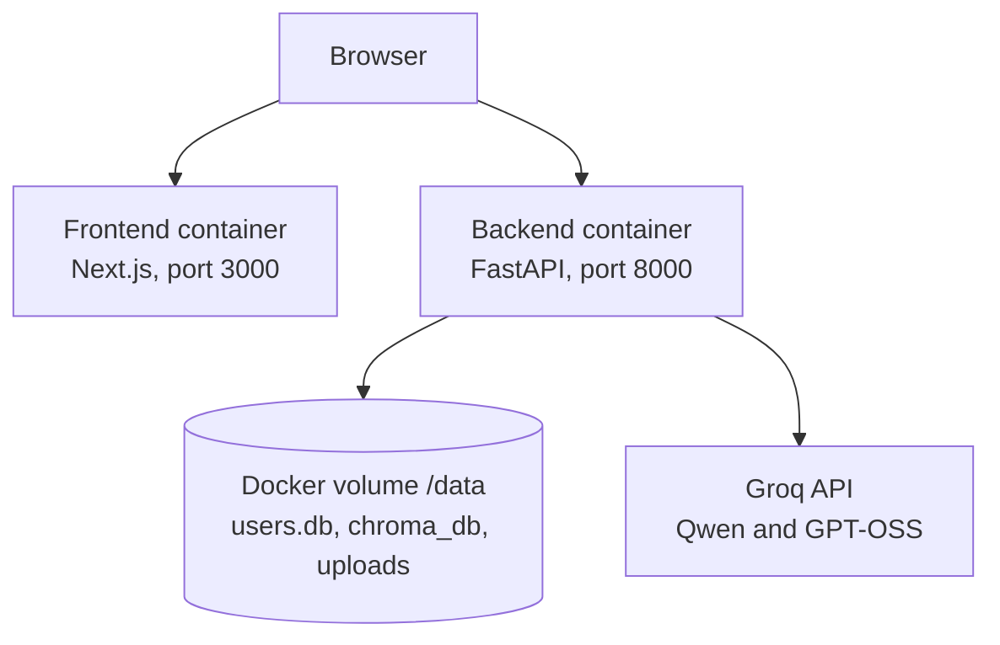

<div align="center">

# TrustRAG AI

### Intelligence you can trust. Every answer is checked before it reaches you.

A secure, document-grounded Q&A app where a second AI **judges every answer** against your document before showing it, and every claim comes with clickable citations.

[](https://github.com/vnsh223/TrustRAG-AI/actions/workflows/docker.yml)


</div>

---

## Why this project exists

Most RAG apps generate an answer and hope it is right. **TrustRAG AI does not release an answer until it has been verified.**

One model (Qwen) writes the answer from your document. A different model (GPT-OSS) then acts as a **judge** and checks two things: is the answer *grounded* in the retrieved passages, and is it *relevant* to the question? Only a `PASS` verdict reaches the user. Anything else is withheld, with a clear reason.

If the judge itself fails, the answer is **not released**. The system fails closed, not open.

<!--
## Screenshots

Add your screenshots to a `docs/` folder, then remove this comment markers.

| Login | Workspace |
|---|---|
|  |  |
-->

## Features

- **Verified answers.** A separate LLM judge checks every document answer for groundedness and relevance before release.
- **Clickable citations.** Each answer links to the exact passages it was built from, shown in an Evidence panel with keyword highlighting.
- **Trust score.** Every answer shows a status badge (Verified, Needs review, Blocked) and a trust score.
- **Strict and General modes.** Strict answers only from your document. General mode may use the model's own knowledge and is clearly labeled as unverified.
- **Private by design.** Accounts use JWT authentication and bcrypt password hashing. Every search is filtered by user ID, and uploads are stored in per-user folders.
- **Guardrails.** Input validation, prompt-injection blocking, retrieved-context validation and generated-answer validation.
- **Document support.** PDF, DOCX and TXT files up to 50 MB, with duplicate detection by content hash.
- **One-command deployment.** The whole stack runs with Docker Compose, with health checks and persistent storage.

## How it works



### Answer statuses

| Status | Meaning |
|---|---|
| `VERIFIED` | The judge passed the answer as grounded and relevant. |
| `REVIEW` | The answer needs more verification and is not shown. |
| `BLOCK` | The answer was not supported by the document, or the request was blocked by a guardrail. |
| `GENERAL_UNVERIFIED` | General mode. Not verified against your document. |
| `CHAT` | Small talk, handled without touching the RAG pipeline. |

## Architecture



## Tech stack

| Layer | Technology |
|---|---|
| Frontend | Next.js 16, React 19, TypeScript, Tailwind CSS, react-markdown |
| Backend | FastAPI, Pydantic, Uvicorn |
| Vector store | ChromaDB (persistent), cosine similarity, built-in embedding function |
| LLMs | Qwen for generation, GPT-OSS for judging, both through the Groq API |
| Auth | JWT, bcrypt, SQLite |
| Document parsing | pypdf, python-docx |
| DevOps | Docker, Docker Compose, GitHub Actions |

## Quick start (Docker)

You only need [Docker](https://docs.docker.com/get-docker/) and a free [Groq API key](https://console.groq.com/).

**1. Clone the repository**

```bash
git clone https://github.com/vnsh223/TrustRAG-AI.git
cd TrustRAG-AI
```

**2. Create your environment file**

```bash
cp backend/.env.example backend/.env
```

Open `backend/.env` and fill in your values:

```env
GROQ_API_KEY=your_groq_api_key_here
JWT_SECRET_KEY=generate_a_long_random_string
MAIN_LLM_MODEL=qwen/qwen3.8-27b
JUDGE_LLM_MODEL=openai/gpt-oss-20b
```

Generate a strong secret with:

```bash
openssl rand -hex 32
```

> **Format matters.** Docker is strict about `.env` files. Write `KEY=value` with **no spaces around `=`** and **no quotes** around values.

**3. Start everything**

```bash
docker compose up --build
```

**4. Open the app**

| Service | URL |
|---|---|
| App | http://localhost:3000 |
| API docs (Swagger) | http://localhost:8000/docs |
| Health check | http://localhost:8000/health |

Register an account, upload a PDF, DOCX or TXT file, and ask a question.

> Use `localhost:3000`, not `127.0.0.1:3000`. The backend's CORS rules allow `localhost:3000`.

### Useful commands

```bash
docker compose ps          # check container health
docker compose logs -f     # follow logs
docker compose down        # stop containers, KEEP your data
docker compose down -v     # stop containers and DELETE all data
```

Your accounts, vector index and uploaded files live in a Docker volume (`trustrag_data`), so they survive restarts and rebuilds.

## Docker design

- **Separate images** for the backend (`python:3.14-slim`) and the frontend (`node:22-alpine`).
- **Non-root users** inside both containers.
- **Dependency layer caching.** Requirements are installed before the code is copied, so rebuilds are fast.
- **Embedding model baked into the image** at build time, so the first request is not slow.
- **One data volume.** A `DATA_DIR` setting points the SQLite database, ChromaDB index and uploads to `/data`. When `DATA_DIR` is not set, the app uses its original local paths.
- **Secrets stay out of images.** Keys are loaded from `backend/.env` at runtime and are excluded by `.dockerignore` and `.gitignore`.
- **Health checks** on both services, and the frontend waits for a healthy backend (`depends_on: service_healthy`).
- **CI.** A GitHub Actions workflow validates the Compose file and builds both images on every push and pull request.

## Run without Docker (development)

**Backend** (Python 3.14)

```bash
cd backend
python -m venv venv
source venv/bin/activate
pip install -r requirements.txt
cp .env.example .env        # then fill in your values
uvicorn app.main:app --reload
```

**Frontend** (Node 22)

```bash
cd frontend
npm install
npm run dev
```

The frontend reads the API address from `NEXT_PUBLIC_API_URL` and defaults to `http://127.0.0.1:8000`.

## API overview

| Method | Endpoint | Description | Auth |
|---|---|---|---|
| `POST` | `/auth/register` | Create an account | No |
| `POST` | `/auth/login` | Log in and receive a JWT | No |
| `GET` | `/documents` | List your documents | Yes |
| `POST` | `/documents/upload` | Upload and index a document | Yes |
| `POST` | `/documents/search` | Semantic search in your documents | Yes |
| `POST` | `/chat` | Ask a question (`strict` or `general` mode) | Yes |
| `GET` | `/health` | Service health check | No |

Full interactive documentation is available at `/docs` when the backend is running.

## Configuration

| Variable | Where | Description |
|---|---|---|
| `GROQ_API_KEY` | `backend/.env` | Your Groq API key |
| `JWT_SECRET_KEY` | `backend/.env` | Secret used to sign login tokens |
| `MAIN_LLM_MODEL` | `backend/.env` | Model that writes answers |
| `JUDGE_LLM_MODEL` | `backend/.env` | Model that judges answers |
| `DATA_DIR` | Set by Docker | Folder for the database, vector index and uploads |
| `NEXT_PUBLIC_API_URL` | Frontend build argument | API address used by the browser (set in `docker-compose.yml`) |

> `NEXT_PUBLIC_API_URL` is baked into the frontend at **build time**. If you change it, rebuild with `docker compose up --build`.

## Project structure

```text
TrustRAG-AI/
├── backend/
│   ├── app/
│   │   ├── main.py                # API routes and the RAG pipeline
│   │   ├── auth.py                # Password hashing and JWT tokens
│   │   ├── database.py            # User accounts (SQLite)
│   │   ├── document_processor.py  # Text extraction (PDF, DOCX, TXT)
│   │   ├── document_chunker.py    # Splits documents into chunks
│   │   ├── vector_store.py        # ChromaDB storage and search
│   │   ├── guardrails.py          # Input, context and answer checks
│   │   ├── llm_service.py         # Answer generation
│   │   └── judge_service.py       # Answer verification
│   ├── Dockerfile
│   ├── requirements.txt
│   └── .env.example
├── frontend/
│   ├── app/
│   │   ├── page.tsx               # Workspace: chats, documents, evidence
│   │   └── components/
│   │       └── AuthScreen.tsx     # Login and registration
│   └── Dockerfile
├── evaluation/                    # Evaluation scripts
├── docker-compose.yml
└── .github/workflows/docker.yml   # CI: validate and build images
```

## Security notes

- Passwords are hashed with bcrypt. Plain-text passwords are never stored.
- Login uses signed JWT tokens, and every protected route checks that the user still exists.
- All vector searches and document listings are filtered by the logged-in user's ID.
- Uploads are limited to PDF, DOCX and TXT, up to 50 MB, and stored in per-user folders.
- Prompt-injection attempts are blocked before they reach the model.
- Containers run as non-root users, and secrets are never baked into images.

## Roadmap

- [ ] Light and dark theme toggle
- [ ] Automated tests for the API and the guardrails
- [ ] Publish Docker images to a container registry
- [ ] Streaming answers

## Author

**Vansh Kumar**

[](https://github.com/vnsh223)
[](https://www.linkedin.com/in/vanshkumar01/)

---

<div align="center">

If this project helped you, consider giving it a star.

</div>